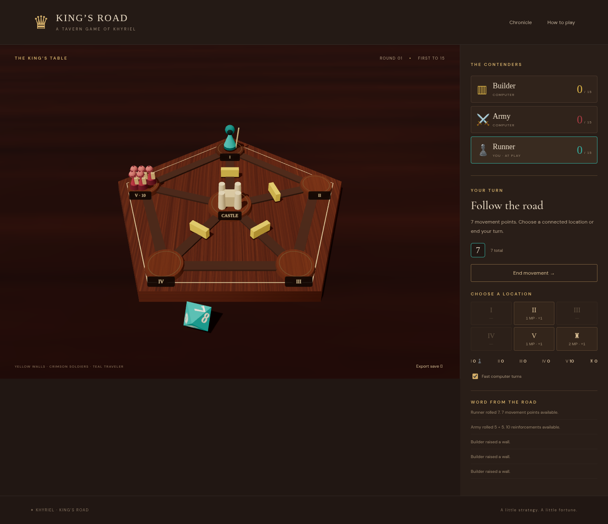

# King’s Road

A browser-only adaptation of Khyriel’s asymmetric tavern game. Play **Builder**, **Army**, or **Runner** against two computer opponents on a carved wooden tabletop.

**[Play King’s Road → https://jesse0michael.github.io/kings-road/](https://jesse0michael.github.io/kings-road/)**

No account, backend, or installation is needed. Games save automatically in your browser.



## Run locally

Install Node.js **22.12 or newer** (the `.nvmrc` selects Node 22), then:

```sh
npm ci
npm run dev
```

Open the address printed by Vite. No environment variables, API keys, or backend services are required. Use a current browser with WebGL and hardware acceleration for the 3D tabletop.

```sh
npm run build           # Type check and create dist/
npm run preview         # Preview the production build
```

The `dist/` directory can be hosted by any static web server. Relative asset paths support subdirectories such as GitHub Pages. Serve it over HTTP; opening `index.html` directly from disk is unsupported.

## At the table

Choose a role; the other two become computer rivals. Turns run **Builder → Army → Runner**. The first to reach **15 points** wins immediately.

| Role    | Dice | Your turn                                                                                                                                                            | Scoring                                                                                          |
| ------- | ---- | -------------------------------------------------------------------------------------------------------------------------------------------------------------------- | ------------------------------------------------------------------------------------------------ |
| Builder | 3d4  | Spend each pair of rolled points on a wall. Tap a highlighted road or an existing wall; each road holds five.                                                        | One point per soldier sacrificed against a wall.                                                 |
| Army    | 2d6  | Move ready soldiers as a group to an adjacent location, or hold them. Then roll and deploy, up to five soldiers per perimeter node, excluding the Runner’s location. | One point per soldier reaching the castle.                                                       |
| Runner  | 1d8  | Spend movement on connected roads, removing walls and one soldier at each occupied destination. End movement whenever you like.                                      | One point per new location that turn. The starting location never scores, including on a return. |

Army soldiers that cannot fit at their destination stay ready at the origin and can try another road. A blocked crossing sacrifices one soldier per wall; surviving soldiers cross if there is room. An open road costs the Runner one movement point; a walled road costs two per wall, including the crossing. Entering a node with soldiers costs one extra movement point and removes exactly one soldier: two points across an open road, three across one wall, or five across two walls. The extra cost does not increase with the number of soldiers. Repeated Runner visits never score again in the same turn, even after all six locations have been visited.

The **Roll** button appears on the table in your role’s color when you can roll. A counter in the table’s upper-right corner shows the active role’s remaining walls, soldiers to deploy, or movement points. During Army movement, it counts soldiers still ready to move. It updates immediately as actions are taken, including on mobile. Army destinations and buildable roads light up when selectable. Roads have generous tap regions; existing walls are also clickable. Place walls, deploy soldiers, and move pieces by tapping the board itself; there are no placement or destination buttons beside it.

The Runner’s **End movement** and Army’s **Hold remaining soldiers** buttons sit directly beneath that counter. Rotating silver coins mark locations that can still award the Runner a point this turn; the starting location has no coin. Each collected coin fades when the traveler arrives, even when moves are queued rapidly. Unvisited coins stay until the turn ends and its queued movement finishes. Coins reset on the next Runner turn, excluding its new starting location. Coins indicate points still available; colored node rings indicate moves you can afford now. Returning through a visited location is legal but earns nothing.

**Word from the Road** is a scrollable event log. Wall placements and deployments accumulate into one total per turn. Army marches record their route, sacrifices, destroyed walls, and castle arrivals. Runner turns record the full route, coins collected, walls destroyed, and soldiers defeated. Rolls stay out of the log; the latest 60 entries save with the game.

The landing page previews your selected role. **How to play** gives each role a card with a short, silent gameplay loop and its scoring rules. Capacity limits sit inside the Builder and Army cards; the Runner card includes movement costs. Each clip has a pause button, pauses offscreen or in a hidden tab, and starts as a still image when reduced motion is enabled.

Preview the [welcome screen](docs/screenshots/welcome.png) and [visual rules](docs/screenshots/how-to-play.png).

Pieces drop, lift, glide, and settle without locking your next action. Computer placements overlap with a short stagger. Runner captures wait for the traveler to arrive. The app respects your system’s reduced-motion preference.

**Settings → Sound at the table** has independent music and effects volume sliders. Music starts at 20%, effects at 40%; zero mutes either channel. Releasing the effects slider, or a keyboard adjustment key, plays a short preview at the selected volume. Preferences are remembered in this browser. **Tavern Dance**, supplied by the game's creator, loops in the background after your first interaction. Audio pauses in a hidden tab. Quiet original effects accompany placements, movement, broken walls, fallen soldiers, castle arrivals, dice, points, and victory; their timing follows the piece animations.

## Saves and history

- Resume the current game with **Return to table** in the header.
- The Chronicle keeps the most recent 100 completed games and their final scores.

Saves belong to this browser and web address. Starting a new game replaces the active game. Clearing browser storage removes saved games and the Chronicle; games do not transfer between browsers, devices, or web addresses.

Read the [original rules and current clarifications](docs/rules.md) and [implementation decisions](docs/design.md).

## Analytics

Terraform creates a dedicated Google Cloud project for King’s Road, provisions Google Analytics 4, and passes the generated Measurement ID into the published build. It tracks visits and gameplay events: role choices, starts/resumes, completed turns, replacements, and final results. Game results include the winner, scores, rounds, and visible playing time. Analytics never blocks gameplay, and local development sends no traffic to Google.

See the [Terraform setup guide](deploy/README.md) for provisioning and the [GA4 reporting guide](docs/analytics.md) for useful reports, data limitations, and local debugging. The Google tag is installed directly; the GTM container is not needed.

## Graphics and technology

React, TypeScript, Vite, and Three.js through React Three Fiber. A separate rules engine validates the same actions for humans and computers.

The scene uses low-poly soldiers with close-held swords and shields, a hooded traveler, and stone walls crossing the roads. Roman numerals, roads, and the central castle are engraved into one continuous wooden board. Generated WebP wood textures, fonts, and models are bundled locally.

Dice have permanent face numbering. Their tumbles are recorded from real Rapier simulations during development, with a verified landing for every d4, d6, and d8 result. The browser replays the appropriate trajectory for the engine’s seeded roll. No number changes or forced orientation correction happen at the end, and no physics engine needs to download at runtime. Read a d4 at its upper tip; read d6 and d8 on their upward face.

```text
src/
  app/App.tsx            # Screens, turn orchestration, human controls
  game/                  # Rules engine, seeded dice, computer strategies
  persistence/           # Validated local saves and game history
  audio/                 # Saved volumes, playback, animation-aligned sound cues
  analytics/             # GA4 events, turn summaries, resumable playing-time clock
  scene/                 # Board, models, hit testing, piece motion, dice
  ui/style.css           # Responsive interface styling
  main.tsx               # Entry point and locally bundled fonts
public/assets/textures/  # Bundled table and board wood textures
public/assets/audio/     # Web music copy and original short sound effects
public/assets/examples/  # Silent gameplay clips and reduced-motion posters
public/icons/            # Carved Seal favicons, touch and home-screen icons
public/site.webmanifest  # Application identity and home-screen launch settings
assets/audio-source/     # Original song, excluded from the web build
assets/brand/            # Approved icon master, excluded from the web build
scripts/generate-dice.mjs # Development-only physics trajectory generator
deploy/                  # Terraform bootstrap and fresh GA4 configuration
docs/                    # Original rules and current design decisions
tests/browser/           # Playwright interaction tests
```

## Validation

```sh
npm test                         # Rules, AI games, persistence, motion, dice, hit targets
npm run build                    # Type check and production bundle
npx playwright install chromium  # Once, if no system Chromium is available
npm run test:browser              # Starts Vite automatically if needed
```

Browser tests cover all three roles, saves/reload, the winning score highlight, history, Runner scoring and coin timing, saved event summaries, overlapping placements, board taps for all roles, Army targets and tabletop controls, audio controls, and mobile layout. Tests use system Chromium when available, otherwise Playwright’s bundled Chromium. Set `PLAYWRIGHT_CHROMIUM_EXECUTABLE` to override its location.

To regenerate the committed dice recordings, use Node **22.18 or newer**, run `npm run dice:generate`, then `npm test`. Ordinary development and deployment use the committed recordings and do not need this step.

Audio assets are also committed. Optional regeneration: `npm run sfx:generate` needs Python 3; `npm run music:prepare` additionally needs FFmpeg/ffprobe. See [audio credits and details](public/assets/audio/README.md).

**Carved Seal** is the selected icon for browser tabs, bookmarks, and home screens. The committed set covers ICO/PNG favicons, Apple touch icons, and Android regular/maskable icons. `npm run icons:generate` regenerates them from the [approved master](assets/brand/README.md) using ImageMagick 7. The web manifest supports a standalone home-screen launch; it does not add offline caching. [Original icon concepts and an effects preview](docs/mockups/README.md) remain available.

`npm run examples:generate` regenerates the tutorial clips using Playwright/Chromium and FFmpeg. It captures the same rules, models, and motion as the game at fixed frame intervals. The capture stage stays outside the production entry point. See [clip details](public/assets/examples/README.md).

## GitHub Pages deployment

After the [one-time Terraform bootstrap](deploy/README.md), pushing to `main` runs [Test and deploy to GitHub Pages](.github/workflows/pages.yml): test, apply infrastructure, build with Terraform's generated analytics configuration, and publish `dist/` using GitHub’s official Pages actions. The workflow also supports a manual run from the Actions tab. Missing bootstrap configuration stops publication and leaves the currently deployed game in place.

The published site is **https://jesse0michael.github.io/kings-road/**. Terraform manages Google Cloud and GA4 through keyless Google authentication. Pages stays in GitHub Actions mode and deploys with the built-in workflow token; no personal GitHub admin token is needed. Publishing a Codex cloud environment is separate from pushing commits and deploying Pages.

## Current limits

This is a playtestable prototype of intentionally asymmetric, unbalanced rules. Computer rivals use simple public-information strategies. There is no multiplayer, cloud synchronization, difficulty selector, or offline/PWA cache. All game logic runs in the browser, but reloading still requires access to the host unless the browser has retained the necessary assets. The camera is fixed, and figures are stylized procedural models.
