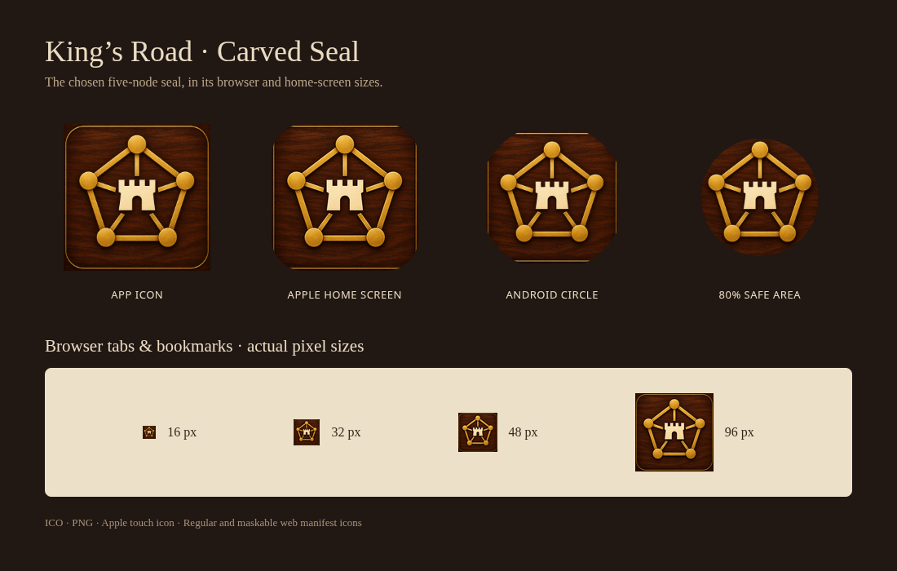

# Carved Seal

The owner selected **B — Carved Seal** from the [icon concepts](../../docs/mockups/README.md). `carved-seal-master.png` is the final square artwork, generated for this project with OpenAI image generation using that approved concept as its reference.

The five brass nodes and roads surround an ivory castle on walnut. The maskable export adds a little padding to keep the complete emblem inside the central circular 80% safe area. The source is opaque and square; the operating system supplies any corner rounding.

Run `npm run icons:generate` with ImageMagick 7 installed to reproduce the committed ICO and PNG exports. Normal application builds use those files directly and require no image tools. The high-resolution master stays outside the public build.

`public/site.webmanifest` supplies the application name, colors, regular and maskable icons, and relative start URL. `index.html` links browser favicons and the Apple touch icon. All paths work from the GitHub Pages project subdirectory. This adds home-screen identity, not offline caching.
