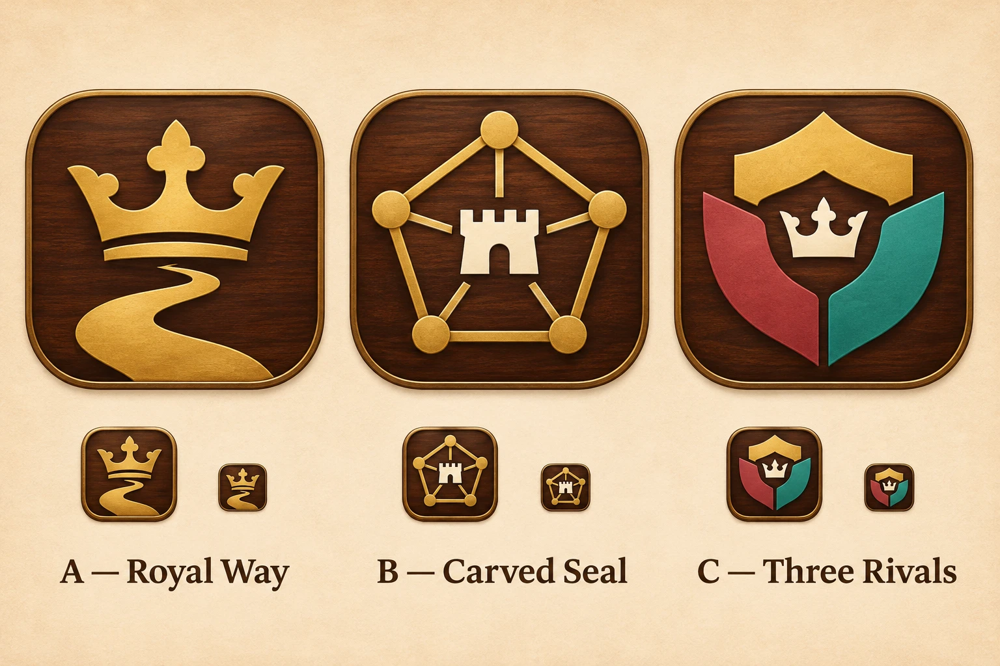

# Icon and sound previews

- **A — Royal Way:** a gold crown and winding road. The clearest silhouette at browser-tab sizes.
- **B — Carved Seal:** the five-node board and central castle.
- **C — Three Rivals:** a crest in the three role colors.

The owner selected **B — Carved Seal**. The completed set includes ICO/PNG favicons, an Apple touch icon, and regular/maskable home-screen icons with a web manifest. See the [final artwork and export instructions](../../assets/brand/README.md). The original comparison is retained above; both the concepts and final master were generated for this project with OpenAI image generation.

[Listen to the original effects](sound-effects.mp3): wall placed, wall broken, Army placed, Army moved, Runner moved, Army fallen, castle reached, point scored, victory, dice. There is a short silence between each cue; in the game they play quietly at the appropriate moment in the animation.
